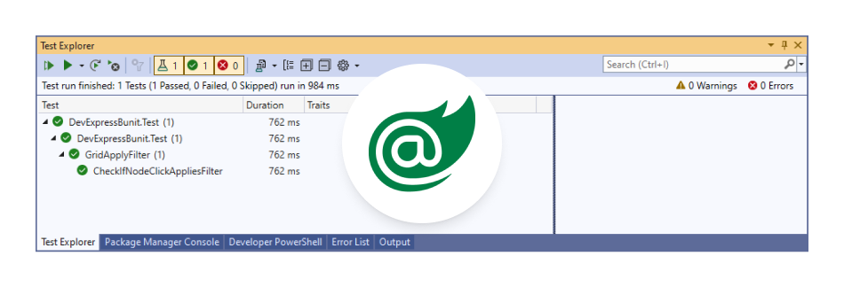

<!-- default badges list -->

[](https://supportcenter.devexpress.com/ticket/details/T1200729)
[](https://docs.devexpress.com/GeneralInformation/403183)
[](#does-this-example-address-your-development-requirementsobjectives)
<!-- default badges end -->
# Blazor - Test DevExpress Components with bUnit

This example adds unit testing to a DevExpress-powered Blazor application. You can find the latest mock implementation for DevExpress dependencies in the _DevExpressBunit.Test_ project. The testing framework is [bUnit](https://bunit.dev/).



Refer to the following help topic for additional information: [Test components with bUnit](https://docs.devexpress.com/Blazor/404603/common-concepts/test-components-with-bunit).

## Upgrade to v26.2+

We simplified bUnit setup in v26.2. If you upgrade from v26.1 or earlier, do the following:

* Remove the `DevExpress.Internal` namespace reference as it is no longer needed.
* Replace the mock class implementation with the following code:

    ```csharp
    testContext.Services.AddSingleton<WeatherForecastService>();
    testContext.Services.AddDevExpressBlazor();
    testContext.JSInterop.Mode = JSRuntimeMode.Loose;
    ```

Review the latest commit in the current branch for more implementation details.

## Files to Review

- [DevExpressComponentTest.cs](./CS/DevExpressBunit.Test/DevExpressComponentTest.cs)
- [GridApplyFilter.cs](./CS/DevExpressBunit.Test/GridApplyFilter.cs)
- [Grid-ApplyFilter.razor](./CS/DxTestProject/Pages/Grid-ApplyFilter.razor)

## Documentation

- [Test components with bUnit](https://docs.devexpress.com/Blazor/404603/common-concepts/test-components-with-bunit)
<!-- feedback -->
## Does This Example Address Your Development Requirements/Objectives?

[](https://www.devexpress.com/support/examples/survey.xml?utm_source=github&utm_campaign=blazor-bunit-tests&~~~was_helpful=yes) [](https://www.devexpress.com/support/examples/survey.xml?utm_source=github&utm_campaign=blazor-bunit-tests&~~~was_helpful=no)

(you will be redirected to DevExpress.com to submit your response)
<!-- feedback end -->
